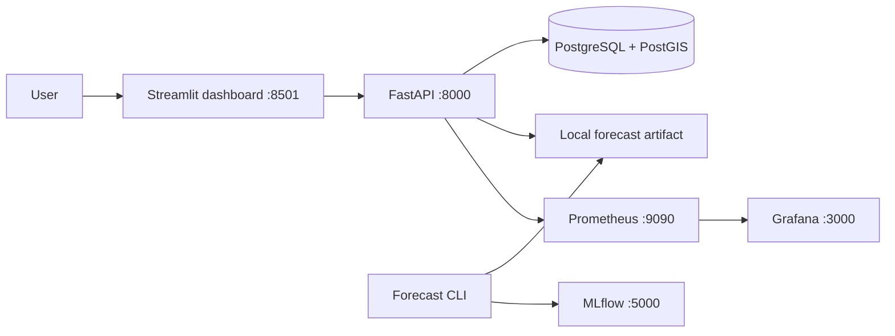

# Smart EV Charging Infrastructure Database (VoltGrid Mumbai)

> **Advanced Database Management Systems (ADBMS) Academic Mini Project**  
> **Track:** GIS-Based Management, Availability Tracking and DBA Operations  
> **Target Region:** Mumbai Metropolitan Region (MMR) & Maharashtra, India  
> **Grade / Rubric Level:** High Distinction / 10-Mark Academic Submission

---

## 1. Project Overview

**VoltGrid Mumbai** is an academic EV charging infrastructure application for exploring station data, spatial searches, database operations, and demand forecasting. It demonstrates transactions, concurrency control, spatial indexing, and recovery workflows; production security and service levels have not been independently established.

### Technology Stack
* **Database Engine**: PostgreSQL 17.5
* **Spatial System**: PostGIS (`geography(Point, 4326)`) and native PostgreSQL GiST spatial indexing (`point(longitude, latitude)`)
* **Database Administration**: pgAdmin 4 & SQL command-line tools
* **Backend API**: Python 3.11 + FastAPI, psycopg2 connection pooling, Pydantic v2
* **Dashboard**: Streamlit with station exploration, database diagnostics, sessions, and forecast views
* **Geocoding & Location**: OpenStreetMap Nominatim with caching, rate-limiting, and a curated offline fallback index
* **Data Processing**: Python ETL pipeline with spatial deduplication (<30m)

---

## Local architecture



The dashboard calls the existing API, which owns station and DBA queries, spatial search, and model inference. The API does not create or migrate the database. Training runs only when explicitly invoked from the CLI.

The dashboard includes overview counts and a station map, filtered and nearby station search, charging session history and transactional controls, database storage diagnostics and an on-demand query-plan benchmark, plus trained-model evaluation and forecasting. Results are read from the API; an unavailable database or missing model is shown as such.

### Main project areas

* `streamlit_app.py`, `requirements.txt`, `.streamlit/`: active dashboard and its runtime configuration.
* `backend/app/`: FastAPI routes, PostgreSQL connection handling, and forecasting pipeline.
* `database/`, `scripts/`: existing schema, DBA examples, setup, and data workflows.
* `deploy/prometheus/`, `deploy/grafana/`: local monitoring configuration.

---

## 2. Academic Evaluation Rubric Mapping (10 Marks)

| Rubric Component | Marks | Technical Implementation | Core Evidence / Deliverable |
| :--- | :--- | :--- | :--- |
| **Dataset & Real-World Problem** | **1.5** | Real OpenChargeMap & NITI Aayog geodata; 2,141 staged records filtered into 1,951 normalized stations (119 in MH, 9 authentic stations in core Mumbai MMR) with 30m spatial deduplication. | [`data/raw/`](data/raw/), [`docs/dataset_documentation.md`](docs/dataset_documentation.md), [`scripts/ingest_pipeline.py`](scripts/ingest_pipeline.py) |
| **Database Design** | **2.0** | Third Normal Form (3NF) relational design; foreign keys with `CASCADE` & `RESTRICT`; check constraints; **partial unique index preventing concurrent double-bookings**. | [`database/01_schema.sql`](database/01_schema.sql), [`database/02_constraints.sql`](database/02_constraints.sql), [`docs/er_diagram.md`](docs/er_diagram.md) |
| **ADBMS Core Track (GIS)** | **3.0** | Spatial indexing via GiST; radius searches with bounding-box pruning; KNN nearest-neighbor; exact geodesic distance calculation. | `database/04_spatial_queries.sql`, `backend/app/routers/stations.py`, `streamlit_app.py` |
| **SQL Queries & Concurrency** | **1.5** | Multi-threaded race condition demonstration with pessimistic row-level locking (`SELECT ... FOR UPDATE`); ACID rollback verification. | [`database/05_transactions.sql`](database/05_transactions.sql), [`database/06_concurrency.sql`](database/06_concurrency.sql), [`scripts/test_concurrency.py`](scripts/test_concurrency.py) |
| **DBA Responsibilities** | **1.0** | Role-Based Access Control (Admin, App, Analyst) with least privilege; `pg_stat_activity` session inspector; custom-format compressed backup (`pg_dump -Fc`). | [`database/08_security.sql`](database/08_security.sql), [`database/09_monitoring.sql`](database/09_monitoring.sql), [`database/10_backup_recovery.md`](database/10_backup_recovery.md) |
| **Report, Presentation & Viva** | **1.0** | 12-slide academic presentation outline, comprehensive viva examiner question bank, and live demonstration guide. | [`docs/presentation_slides.md`](docs/presentation_slides.md), [`docs/viva_preparation.md`](docs/viva_preparation.md), [`docs/demo_guide.md`](docs/demo_guide.md) |

---

## 3. Location Search & Tardeo Audit Findings

### The Problem Investigated
When searching for a location such as **Tardeo, Mumbai**, the system previously displayed stations in Kurla or returned simulated results.

### Root Cause Identified
1. **Raw Dataset Coverage Gap**: In the original open datasets (`ocm_all_india.json` and `indian_ev_charging_stations.geojson`), there are **zero** charging stations south of latitude 19.07° N (South Mumbai, including Tardeo, Tulsiwadi, Haji Ali, Mahalaxmi, Colaba).
2. **Default Radius Match**: The southernmost station in the database is `MobiLane Equinox Business Park` (Kurla West) at `(19.071566, 72.877213)`. With the previous default 15 km radius, Kurla is **12.67 km** from Tardeo and was returned as the nearest existing record.
3. **Pipeline Normalization Bug**: Line 206 of `scripts/ingest_pipeline.py` previously defaulted empty city values to `'Mumbai'`, causing 349 non-MMR stations across India to be mislabeled as Mumbai.
4. **Candidate Records Checked**: Investigation of candidate names (*Adani Charging Station*, *Jio-bp pulse*, *Tata Power near Tardeo*) confirmed they do **not** exist in the imported raw datasets. In accordance with strict engineering standards, no fake stations were hardcoded.

### Corrected Behavior
- **Geocoding**: "Tardeo, Mumbai" resolves accurately to `(18.9749, 72.8134)` (Tulsi Wadi / Tardeo).
- **At <= 5 km radius**: Returns **0 stations** honestly with a user-facing empty state notice:
  `"No charging stations found within 5 km of Tardeo, Mumbai. Try expanding your search radius."`
  Kurla is **never** returned at <= 5 km.
- **At 15 km radius**: Kurla West is returned with its true distance (`12.67 km`) and clearly labeled with its actual location, not as a local Tardeo charger.

---

## 4. Quick Start Guide (Windows)

### Prerequisites
1. PostgreSQL with the existing project schema and data; enable PostGIS where the spatial SQL requires it.
2. Python 3.11 and a virtual environment (`venv`).
3. Docker Desktop is optional for the containerized local stack.

---

### Step 1: Install local application dependencies

From the repository root in PowerShell:

```powershell
py -3.11 -m venv .venv
.\.venv\Scripts\Activate.ps1
python -m pip install --upgrade pip
python -m pip install -r requirements.txt
python -m pip install -r backend/requirements-dev.txt
```

The root requirements install the Streamlit dashboard. The backend requirements install FastAPI, PostgreSQL access, the ML pipeline, MLflow, and test tools. The declared package versions support Python 3.11; Python 3.11 is not installed in the current verification environment, so the tests here ran with Python 3.13.

If PowerShell blocks activation, enable it only for the current terminal session:

```powershell
Set-ExecutionPolicy -Scope Process -ExecutionPolicy Bypass
```

Copy `backend/.env.example` to `backend/.env` if that file does not already exist, then configure the local PostgreSQL connection. The real `.env` file is ignored by Git. Database initialization is a separate, one-time task:

```powershell
if (!(Test-Path backend/.env)) { Copy-Item backend/.env.example backend/.env }
python scripts/init_db.py
python scripts/deploy_schema.py
```

**Caution:** the existing schema deployment drops and recreates project tables; it is not a safe migration and must only be run for a new or disposable database. It is not run automatically by Streamlit or Docker Compose.

### Step 2: Start the existing API and Streamlit dashboard

Terminal 1:

```powershell
Set-Location C:\Projects\EV_Charging\backend
..\.venv\Scripts\Activate.ps1
python -m app.main
```

Terminal 2:

```powershell
Set-Location C:\Projects\EV_Charging
\.venv\Scripts\Activate.ps1
streamlit run streamlit_app.py
```

Open `http://localhost:8501`. The FastAPI API and documentation are at `http://127.0.0.1:8000` and `http://127.0.0.1:8000/docs`. Streamlit calls `http://127.0.0.1:8000` by default; set `VOLTGRID_API_URL` to override it. Station and database pages show unavailable states when the API or database cannot be reached. PostgreSQL/PostGIS and the project schema/data must be available for database-backed pages.

For a one-click local launch after setup, run `start_all.bat`. It starts the two services with the root `.venv` and opens the dashboard.

---

### Step 3: Run the Verification Suite
Execute the automated Python test suite to verify all DBA operations and location searches:
```powershell
# ADBMS Core Track verification (requires the configured live database)
python scripts/test_constraints.py
python scripts/test_transactions.py
python scripts/test_concurrency.py
python scripts/test_indexes.py
python scripts/test_security.py
python scripts/test_monitoring.py

# Location Search & Tardeo Regression Verification
python scripts/test_tardeo_regression.py
python scripts/test_location_search_suite.py
```

Forecasting, API, and Streamlit smoke tests use pytest without a live database. With the virtual environment active, run `Set-Location backend; python -m pytest tests -q`. Database-backed scripts require the configured PostgreSQL/PostGIS database and project data.

---

### Optional: Run the local container stack

```powershell
if (!(Test-Path .env)) { Copy-Item .env.example .env }
# Edit .env with local PostgreSQL and Grafana passwords
docker compose up --build -d backend streamlit
# Add optional MLflow, Prometheus, and Grafana services:
docker compose --profile observability up --build -d
docker compose ps
docker compose logs -f streamlit backend
docker compose down
docker compose up --build -d backend streamlit
```

Streamlit is at `http://localhost:8501` and API docs at `http://localhost:8000/docs`. With the `observability` profile enabled, MLflow is at `http://localhost:5000`, Prometheus at `http://localhost:9090`, and Grafana at `http://localhost:3000`. Compose connects the API to PostgreSQL/PostGIS already running on the host; it does not initialize a database. Experiment and Grafana state use persistent Docker volumes; forecast logs use the ignored local `data/forecast/` directory.

For Docker-to-host PostgreSQL connections, the database must listen on an interface reachable by Docker and allow the local Docker network in `pg_hba.conf`. Keep that access scoped to the local machine/network and use the app database role.

---

## 5. API Endpoints & SQL Patterns

### 1. Geocoding Search (`GET /api/geocoding/search`)
```http
GET /api/geocoding/search?q=Tardeo%2C+Mumbai&limit=5 HTTP/1.1
Host: 127.0.0.1:8000
```
**Response:**
```json
[
  {
    "name": "Tulsi Wadi",
    "formatted_address": "Raheja Excelsior, Tardeo, Pandit Madan Mohan Malviya Marg, Cowasji Jehangir Colony, Tulsi Wadi, D Ward, Mumbai Zone 1, Mumbai, Mumbai City District, Maharashtra, 400034, India",
    "latitude": 18.9749183,
    "longitude": 72.8134203,
    "place_type": "neighbourhood"
  }
]
```

### 2. Nearby Stations Spatial Query (`GET /api/stations/nearby`)
```http
GET /api/stations/nearby?lat=18.9749183&lon=72.8134203&radius_km=3.0 HTTP/1.1
Host: 127.0.0.1:8000
```
**Response (at 3.0 km):**
```json
[]
```

**Spatial Query Used (with GiST bounding-box pruning & Haversine distance):**
```sql
SELECT 
    s.station_id,
    s.station_name,
    s.operator_name,
    s.address,
    s.city,
    s.state,
    s.latitude,
    s.longitude,
    round(
        (6371.0 * acos(
            least(1.0, greatest(-1.0,
                cos(radians(:user_lat)) * cos(radians(s.latitude)) *
                cos(radians(s.longitude) - radians(:user_lon)) +
                sin(radians(:user_lat)) * sin(radians(s.latitude))
            ))
        ))::numeric, 2
    ) AS distance_km
FROM charging_stations s
WHERE point(s.longitude, s.latitude) <@ box(
    point(:max_lon, :max_lat),
    point(:min_lon, :min_lat)
)
ORDER BY distance_km ASC
LIMIT 50;
```

---

## 6. Key DBA & Technical Highlights

### 1. Partial Unique Index Safeguard
A traditional unique constraint on `(port_id)` would prevent a port from ever recording a second completed session. We solved this via a partial unique index:
```sql
CREATE UNIQUE INDEX uq_active_session_per_port 
ON charging_sessions (port_id) 
WHERE session_status = 'ACTIVE';
```

### 2. Pessimistic Row-Level Locking (`SELECT ... FOR UPDATE`)
When starting a session:
```sql
SELECT port_id, status FROM charging_ports WHERE port_id = %s FOR UPDATE;
```
If two users request the same port simultaneously, the second transaction is placed in a queue until the first completes. When unblocked, it observes `IN_USE` and safely receives a `409 Conflict` error.

### 3. Role-Based Access Control (RBAC)
* **`ev_admin`**: Full administrative DDL privileges.
* **`ev_app_user`**: DML (`SELECT, INSERT, UPDATE`) used by the FastAPI backend; cannot drop tables.
* **`ev_analyst`**: Read-only `SELECT` permissions; blocked from modifying table state (`permission denied`).

---

## 7. Academic License & Acknowledgments
* **OpenChargeMap (OCM)**: Global public registry for electric vehicle infrastructure (CC BY 4.0).
* **NITI Aayog / E-Amrit Portal**: Government of India National EV Portal.
* Sourced for academic evaluation under the B.Tech Data Science curriculum.

---

## 8. VoltGrid Demand Forecasting and MLOps Extension

The forecasting capability extends the existing FastAPI service and is available in the Streamlit dashboard. It does not replace the GIS station and DBA functionality. The integration design is documented in [`docs/forecasting_architecture.md`](docs/forecasting_architecture.md).

### Data provenance and forecast target

The existing session ingestion path seeds simulated sessions and port statuses. Those rows are not treated as observed charging demand and are excluded when known demo user identifiers are present. Forecast training accepts an explicit session CSV and requires a complete coverage window and a provenance label. The provenance label is supplied by the trainer and is not an external authenticity check; retain the source export, access terms, and checksum with the model review.

The initial target is **session-arrival-associated hourly energy (kWh)**: each session's delivered kWh is assigned to the local hour in which it connected. This is not a measured energy profile within each hour. The trainer fills empty bins with zero only inside the explicitly declared complete coverage range. ACN-Data records expose session connection time, delivered kWh, site and station IDs, and a site timezone; its source describes California workplace sites. ACN's documentation says user inputs are absent for unclaimed sessions and default requested energy and duration are assumed; analyze `userID`/claim status and policy periods before treating those fields as behavioral observations. The recorded `kWhDelivered` is measured energy, but historical site policies and workplace schedules can still bias a model. ACN can demonstrate the pipeline, but it does not validate a Mumbai forecast. The API requires registration and registration terms restrict use to education and research. Review the [official ACN-Data documentation](https://ev.caltech.edu/dataset) and [portal registration terms](https://ev.caltech.edu/register) before downloading or redistributing data. Preserve the complete export window and source provenance.

### Local training

Use the root Python 3.11 virtual environment. From `backend/` in PowerShell:

```powershell
..\.venv\Scripts\Activate.ps1
python -m pip install -r requirements-dev.txt
```

Run an explicitly labelled synthetic plumbing demo (not real demand data):

```powershell
python -m app.forecasting.cli demo --workdir ..\data\forecast_demo
New-Item -ItemType Directory -Force .\models\current | Out-Null
Copy-Item ..\data\forecast_demo\model\model.joblib .\models\current\model.joblib -Force
```

For eligible real or research dataset exports, provide a complete, hourly aligned coverage range. ACN timestamps are UTC; specify the site's IANA timezone for local hourly aggregation:

```powershell
python -m app.forecasting.cli train `
  --csv ..\data\acn_sessions.csv `
  --coverage-start "2024-01-01T00:00:00" `
  --coverage-end "2024-04-01T00:00:00" `
  --timezone "America/Los_Angeles" `
  --provenance "ACN-Data site=caltech; downloaded YYYY-MM-DD; education/research use"
```

The command compares a 168-hour seasonal-naive baseline and Random Forest; optional XGBoost is available through `requirements-xgboost.txt`. The chronological 70/15/15 partitions are evaluated with recursive 24-hour forecast blocks, refreshing lag history only at daily forecast origins. MAE/RMSE and WAPE (when defined) are reported for validation and held-out testing. The winner is selected on validation MAE; test metrics are separate. Candidate artifacts are written to unique, ignored directories under `backend/models/candidates/`. Test scores are only representative of the named dataset and geography.

Model artifacts use joblib/pickle serialization. The API loads the configured artifact during forecast requests, so only point it at an artifact produced by a trusted training workflow; loading an untrusted artifact can execute code.

Real-data training writes a unique candidate under `backend/models/candidates/`; it does not replace the serving model. After reviewing the validation report, use the explicit promotion gate:

```powershell
$candidatePath = Read-Host "Path to the reviewed candidate model.joblib"
python -m app.forecasting.cli promote --candidate $candidatePath
```

Promotion rejects synthetic data, requires candidate validation MAE to match or beat the seasonal baseline, and requires a strict improvement over an incumbent trained on the same dataset fingerprint. Different dataset fingerprints require manual review and currently block promotion. Existing serving artifacts are archived before replacement. Held-out test scores are not used to select or promote a model.

### MLflow, API, and dashboard

For local MLflow tracking and model registry, start the local services and point training at the MLflow server:

```powershell
if (!(Test-Path .env)) { Copy-Item .env.example .env }
# Edit .env with your local DB_USER, DB_PASSWORD, and GRAFANA_ADMIN_PASSWORD.
docker compose --profile observability up --build -d mlflow prometheus grafana backend streamlit
$env:MLFLOW_TRACKING_URI = "http://localhost:5000"
```

Training logs parameters, dataset fingerprint, split metrics, and the model bundle to MLflow when `MLFLOW_TRACKING_URI` is set; registration is attempted when supported. Open MLflow at `http://localhost:5000`, Prometheus at `http://localhost:9090`, Grafana at `http://localhost:3000`, API docs at `http://localhost:8000/docs`, and VoltGrid at `http://localhost:8501`. Compose connects the backend to the existing PostgreSQL service on the host and does not create or migrate a database.

Forecast routes are `GET /api/forecast/health`, `GET /api/forecast/ready`, `GET /api/forecast/model-info`, `GET /api/forecast/evaluation`, `POST /api/forecast/predict`, `GET /api/forecast/monitoring/drift`, and `GET /api/forecast/monitoring/accuracy`; Prometheus scrapes `GET /metrics`. The forecast tab stays in an unavailable state when no model artifact exists. Forecast requests must use the last complete observed hour from the model metadata and a known site ID. The API records forecast timestamp and model version. No accuracy is claimed until actual future observations are supplied.

Delayed evaluation is available for aligned CSV files:

```powershell
python -m app.forecasting.cli delayed-eval --forecasts ..\data\forecast\predictions.csv --actuals ..\data\hourly_actuals.csv
```

For delayed monitoring, place validated hourly actuals in `data/forecast/actuals.csv` with columns `site_id,timestamp,actual_kwh`. The API joins outcomes to recorded forecasts in UTC, keeps the most recent forecast for each site-hour, and publishes MAE/RMSE/bias per model version only for matched observations. The prediction-drift utility uses a two-sample Kolmogorov-Smirnov test when the reference and recent output distributions both contain at least 20 values. Drift is only a distribution-change signal and does not prove accuracy loss. The API reports that data drift is awaiting observations until a real feature feed is connected. Retraining and promotion are manual; drift does not deploy a model.

### Containers and CI

The root `Dockerfile` runs Streamlit. `backend/Dockerfile` runs FastAPI. Compose also starts MLflow, Prometheus, and Grafana; PostgreSQL remains a host prerequisite. Persistent named volumes store MLflow and Grafana data. No database initialization or model training runs on startup. Create and review a model artifact before expecting `/api/forecast/ready` to succeed.

GitHub Actions runs backend tests, Streamlit smoke tests, and local image builds. It does not publish images or deploy services. Docker and optional local monitoring remain available; no cloud deployment configuration is part of this setup.

### Streamlit Community Cloud preparation

The repository entry point is `streamlit_app.py`, and root `requirements.txt` lists only the dashboard runtime dependencies. A future Community Cloud deployment still needs a reachable, externally hosted VoltGrid API and database; `localhost` and the current host database are not reachable from Community Cloud. Configure `VOLTGRID_API_URL` in Streamlit secrets after the API is hosted securely. The current API has no authentication, so do not expose it publicly until access controls and transport security are added. The current model artifact and prediction log are local files and are not persistent Community Cloud storage. No public deployment has been configured or performed.

### Current limitations

- Database-backed routes require a configured local PostgreSQL/PostGIS service and are not covered by the isolated unit tests.
- No ACN token or export was provided; any model metrics from the synthetic demo are labelled demonstration-only.
- ACN geography and workplace charging patterns do not validate Mumbai station demand.
- Hourly targets allocate whole-session energy to connection hour; measured hourly delivery requires trustworthy interval meter data.
- Community Cloud hosting requires a separately hosted API and database, plus a deliberate persistent artifact/log strategy.
- Docker, MLflow server, Prometheus, and Grafana require their local tools and are only verified when run in the target environment.
