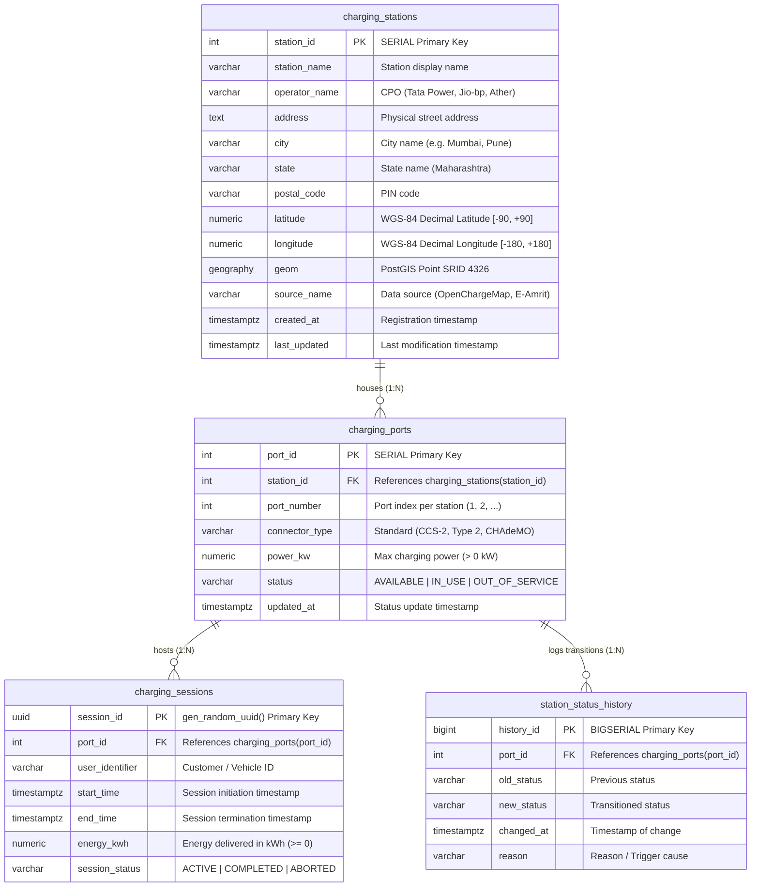

# Entity-Relationship (ER) Diagram & Schema Documentation

## 1. Conceptual Model

The database is modeled around the real-world operational domain of Electric Vehicle (EV) Charging Networks in urban metropolitan areas. The schema satisfies **Third Normal Form (3NF)**:
- Every non-key attribute is non-transitively dependent on the primary key.
- Physical infrastructure (stations and hardware ports) is decoupled from operational business transactions (charging sessions) and audit logs (temporal status history).

---

## 2. Mermaid Entity-Relationship (ER) Diagram



---

## 3. Relational Cardinalities & Referential Integrity

| Relationship | Cardinality | Foreign Key Constraint | Delete Action | Business Justification |
| :--- | :--- | :--- | :--- | :--- |
| **`charging_stations` $\to$ `charging_ports`** | $1 : N$ | `charging_ports.station_id` $\to$ `charging_stations.station_id` | `ON DELETE CASCADE` | If a physical station is decommissioned, all attached hardware ports are removed. |
| **`charging_ports` $\to$ `charging_sessions`** | $1 : N$ | `charging_sessions.port_id` $\to$ `charging_ports.port_id` | `ON DELETE RESTRICT` | **Critical DBA Rule**: A port cannot be deleted if historical charging or billing session records exist. |
| **`charging_ports` $\to$ `station_status_history`** | $1 : N$ | `station_status_history.port_id` $\to$ `charging_ports.port_id` | `ON DELETE CASCADE` | Temporal telemetry records cascade if a test port is deleted. |

---

## 4. Key Constraints & DBA Safeguards

1. **Partial Unique Index (Double-Booking Prevention)**:
   ```sql
   CREATE UNIQUE INDEX uq_active_session_per_port 
   ON charging_sessions (port_id) 
   WHERE session_status = 'ACTIVE';
   ```
   *Guarantees at database engine level that no two concurrent `ACTIVE` sessions can ever be created for the same physical connector.*

2. **Domain Check Constraints**:
   - `chk_latitude_range`: `latitude BETWEEN -90.0 AND 90.0`
   - `chk_longitude_range`: `longitude BETWEEN -180.0 AND 180.0`
   - `chk_power_positive`: `power_kw > 0.0`
   - `chk_connector_type`: `connector_type IN ('CCS-2', 'Type 2 AC', 'CHAdeMO', 'GB/T', 'Bharat AC-001', 'Bharat DC-001')`
   - `chk_port_status`: `status IN ('AVAILABLE', 'IN_USE', 'OUT_OF_SERVICE', 'MAINTENANCE')`
   - `chk_session_times`: `end_time IS NULL OR end_time >= start_time`
